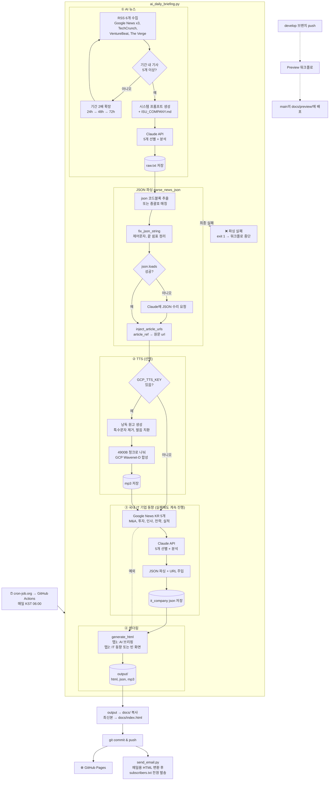

# AI Daily Briefing Generator

Google RSS 피드로 뉴스를 수집하고 Claude API로 분석해 HTML 뉴스레터 + 음성 파일을 생성하는 자동화 도구.
GitHub Actions로 매일 아침 6시(KST)에 자동 실행되어 GitHub Pages에 배포됩니다.

## 구조

```
ai_daily_briefing/
├── ai_daily_briefing.py        # 메인 스크립트 (Anthropic Claude)
├── ai_daily_briefing_openai.py # OpenAI 버전
├── briefing_core.py            # 공통 로직 (RSS, 프롬프트, 파싱, TTS, HTML)
├── send_email.py               # 구독자 이메일 발송
├── isu_context.md              # 회사 맞춤 인사이트 컨텍스트
├── .github/workflows/
│   └── daily-briefing.yml      # GitHub Actions 자동화
├── docs/                       # GitHub Pages 배포 디렉토리
└── output/                     # 로컬 생성 결과물 (gitignore)
    ├── ai_briefing_YYYY_MM_DD.html
    ├── ai_briefing_YYYY_MM_DD.json
    └── ai_briefing_YYYY_MM_DD.mp3
```

## 빠른 시작

```bash
# 1. 의존성 설치
pip install anthropic feedparser requests

# 2. API 키 설정
export ANTHROPIC_API_KEY="sk-ant-..."

# 3. 실행
python ai_daily_briefing.py

# 4. 결과 확인
open output/ai_briefing_$(date +%Y_%m_%d).html
```

### TTS 음성 파일 생성 (선택)

GCP Cloud Text-to-Speech API Key를 설정하면 MP3 파일이 함께 생성됩니다.

```bash
export GCP_TTS_KEY="AIzaSy..."
python ai_daily_briefing.py
# → output/ai_briefing_YYYY_MM_DD.mp3 생성
# → HTML 우하단에 오디오 플레이어 삽입
```

GCP 콘솔 → APIs & Services → Credentials → API Key 발급 후 Cloud Text-to-Speech API 제한 설정 권장.

## 작동 원리



- 별도의 뉴스 API 없이 Google RSS 피드로 수집
- 회사 맞춤 인사이트는 `isu_context.md`에 컨텍스트 정의

## GitHub Actions 자동화

매일 KST 06:00에 외부 스케줄러(cron-job.org)가 `workflow_dispatch` API를 호출해 실행합니다. 설정 방법은 [SCHEDULING.md](SCHEDULING.md) 참고.

저장소 Secrets에 등록 필요:

| Secret | 설명 |
|--------|------|
| `ANTHROPIC_API_KEY` | Claude API 키 (필수) |
| `GCP_TTS_KEY` | GCP TTS API 키 (선택, 없으면 TTS 생략) |
| `GMAIL_ADDRESS` | 발송 Gmail 주소 (이메일 발송 시) |
| `GMAIL_APP_PASSWORD` | Gmail 앱 비밀번호 (이메일 발송 시) |

실행 순서: 브리핑 생성 → docs/ 복사 → commit & push → 이메일 발송

## 비용

| 항목 | 단가 | 1회 비용 |
|------|------|----------|
| Claude Sonnet 4.6 | $3/$15 per 1M tokens | ~$0.03~$0.05 |
| GCP WaveNet TTS | $16 per 1M chars | ~$0.01 |
| **합계** | | **~$0.04~$0.06 (≈60~90원)** |

월 30회 실행 시 약 1,800~2,700원 수준.

## 커스터마이징

### 뉴스 주제 변경
`collect_and_analyze_news()`의 `system_prompt`를 수정.

### 회사 맞춤 인사이트
`isu_context.md`에 회사/조직 컨텍스트를 작성하면 각 뉴스에 맞춤 인사이트가 추가됩니다.

### TTS 목소리 변경
`generate_tts_audio()`의 `voice.name` 수정:
- `ko-KR-Wavenet-A` ~ `ko-KR-Wavenet-D` (남/여 4종)

### 모델 변경
- `claude-sonnet-5-5`: 기본 추천 (가성비)
- `claude-opus-5-5`: 더 깊은 분석 (비용 ~5x)
- `claude-haiku-4-5`: 비용 최소화
